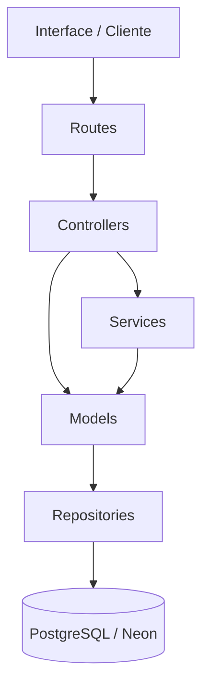

# MExplica

Plataforma acadêmica de inclusão e acessibilidade digital.

O **MExplica** é uma aplicação web desenvolvida para auxiliar principalmente idosos e pessoas com dificuldades na utilização de dispositivos, aplicativos e serviços tecnológicos.

A plataforma oferece conteúdos educativos, tutoriais passo a passo e um ambiente colaborativo no qual usuários podem compartilhar conhecimentos e auxiliar outras pessoas.

**Status:** Aplicação funcional publicada.

[🌐 Acessar o MExplica](https://mexplica-atualizado.vercel.app/)

---

## Objetivo

O projeto busca contribuir para a inclusão digital por meio de uma plataforma simples, acessível e colaborativa.

Além de facilitar o acesso a orientações sobre tecnologia, o MExplica permite que colaboradores produzam conteúdos, compartilhem experiências e contribuam com a comunidade.

---

## Principais funcionalidades

### Usuários e autenticação

- Cadastro e gerenciamento de usuários;
- Login por e-mail ou telefone;
- Autenticação JWT;
- Controle de acesso e permissões;
- Perfis de usuários;
- Sistema de colaboradores.

### Tutoriais e conteúdos

- Pesquisa e filtragem de conteúdos;
- Tutoriais organizados em etapas;
- Categorias e tags;
- Suporte a imagens e vídeos;
- Criação, visualização, edição e exclusão de tutoriais.

### Comunidade

- Comentários em tutoriais;
- Avaliações de conteúdos;
- Sistema de pontuação;
- Níveis de colaboradores;
- Ranking de colaboradores.

### Acessibilidade digital

- Ajuste do tamanho dos textos;
- Modo escuro;
- Modo de conforto ocular;
- Integração com VLibras;
- Interface responsiva;
- Conteúdos organizados para facilitar a compreensão.

---

## Moderação MExplica

A plataforma possui um módulo administrativo destinado ao gerenciamento e à moderação de conteúdos e usuários.

O painel permite:

- Visualização de indicadores da plataforma;
- Gerenciamento de usuários;
- Moderação de tutoriais;
- Moderação de comentários;
- Moderação de avaliações;
- Pesquisa e paginação de registros;
- Remoção de conteúdos conforme permissões administrativas.

O acesso é restrito a usuários autorizados pelo backend. As permissões administrativas são verificadas a partir do estado atual do usuário no banco de dados.

Contas administrativas possuem proteção contra exclusão pelos fluxos disponibilizados pela aplicação.

---

## Tecnologias utilizadas

| Categoria | Tecnologias |
|---|---|
| Frontend | HTML, CSS, JavaScript e EJS |
| Backend | Node.js e Express |
| Banco de dados | PostgreSQL e Neon |
| Autenticação | JWT e bcrypt |
| Arquitetura | MVC, Services e Repositories |
| Testes | Node.js Test Runner |
| Controle de versão | Git e GitHub |
| Hospedagem | Vercel |

---

## Arquitetura de software

O MExplica utiliza uma arquitetura baseada em MVC (Model-View-Controller), complementada por camadas responsáveis pelas regras de negócio e persistência dos dados.

O objetivo é promover a separação de responsabilidades, facilitar a manutenção e reduzir o acoplamento entre os componentes.

### Fluxo da aplicação



A camada Service é utilizada quando existem regras de negócio, composição de informações ou operações que envolvem múltiplas entidades.

### Responsabilidades

| Camada | Responsabilidade |
|---|---|
| Routes | Definição dos endpoints |
| Controllers | Tratamento das requisições HTTP |
| Services | Regras de negócio e operações compostas |
| Models | Operações relacionadas às entidades |
| Repositories | Acesso e persistência dos dados |
| Middlewares | Autenticação, autorização e funções intermediárias |
| Views | Renderização das interfaces |

---

## Estrutura do projeto

```text
mexplica/
├── api/
├── public/
│   ├── css/
│   └── js/
├── src/
│   ├── controllers/
│   ├── data/
│   ├── database/
│   ├── events/
│   ├── middlewares/
│   ├── models/
│   ├── observers/
│   ├── repositories/
│   ├── routes/
│   ├── services/
│   ├── utils/
│   ├── views/
│   └── index.js
├── scripts/
├── tests/
├── docs/
├── .env.example
├── package.json
├── package-lock.json
├── vercel.json
└── README.md
```

---

## Padrões de projeto

O projeto utiliza padrões de projeto para resolver necessidades específicas da arquitetura.

### Factory

A RepositoryFactory seleciona a implementação de persistência de acordo com o ambiente da aplicação.

- Ambiente de testes: repositories em memória.
- Ambiente de execução: repositories PostgreSQL.

Essa separação permite executar testes offline sem acessar o banco de dados real.

### Singleton

A classe DatabaseConnection centraliza a criação e reutilização do pool de conexões PostgreSQL dentro de cada processo ou instância da aplicação.

### Observer

O padrão Observer é utilizado no ciclo de avaliações e pontuação dos colaboradores.

Eventos relacionados à criação, atualização ou remoção de avaliações notificam o observador responsável pelo ajuste da pontuação, preservando a integridade da operação por meio de transações.

---

## Banco de dados

A persistência da aplicação é realizada através do PostgreSQL, hospedado no Neon.

O banco de dados contempla informações relacionadas a:

- Usuários;
- Tutoriais;
- Etapas dos tutoriais;
- Tags;
- Comentários;
- Avaliações.

O sistema utiliza relacionamentos entre entidades, consultas parametrizadas, transações e mecanismos de integridade.

Os dados em memória são utilizados exclusivamente para testes e dados demonstrativos destinados ao seed.

---

## API REST

A comunicação entre os componentes da aplicação utiliza uma API HTTP organizada por recursos.

### Principais grupos de endpoints

| Recurso | Rota base |
|---|---|
| Autenticação | /api/auth |
| Usuários | /api/usuarios |
| Tutoriais | /api/tutoriais |
| Comentários | /api/comentarios |
| Avaliações | /api/avaliacoes |
| Administração | /api/admin |
| Saúde da aplicação | /api/health |

Os endpoints implementam operações CRUD conforme as necessidades de cada recurso e suas respectivas regras de autorização.

---

## Autenticação e segurança

A aplicação utiliza mecanismos de autenticação e autorização baseados em:

- JSON Web Token (JWT);
- Hash de senhas com bcrypt;
- Cookies HttpOnly;
- Cookies Secure em produção;
- Autenticação Bearer nas APIs;
- Validação de permissões no backend;
- Consultas parametrizadas;
- Proteção de contas administrativas;
- Tratamento controlado de erros.

Credenciais e variáveis de ambiente não devem ser armazenadas no repositório.

---

## Executando o projeto localmente

### Pré-requisitos

- Node.js 24;
- npm;
- Git;
- Banco PostgreSQL previamente configurado.

### 1. Clonar o repositório

```bash
git clone https://github.com/pedroohns/mexplica.git
cd mexplica
```

### 2. Instalar as dependências

```bash
npm ci
```

### 3. Configurar as variáveis de ambiente

Crie um arquivo `.env` com base no arquivo `.env.example`.

```env
DATABASE_URL=
JWT_SECRET=
```

Configure a URL de conexão com um banco PostgreSQL de desenvolvimento e uma chave JWT forte.

Nunca compartilhe ou versione os valores reais dessas variáveis.

A preparação do schema e a execução de migrations são procedimentos separados. Consulte a documentação de banco de dados antes de executar comandos que alterem a estrutura ou o conteúdo do banco.

### 4. Iniciar a aplicação

```bash
npm run dev
```

Acesse:

http://localhost:3000

---

## Testes

O projeto possui uma suíte automatizada utilizando o test runner nativo do Node.js.

```bash
npm test
```

A suíte contempla testes relacionados a:

- Endpoints da API;
- Autenticação e autorização;
- Regras de negócio;
- Persistência e repositories;
- Integridade de relacionamentos;
- Operações administrativas;
- Padrões de projeto;
- Estrutura da aplicação.

Os testes utilizam dados em memória e implementações simuladas, sem necessidade de conexão com o banco de produção.

---

## Documentação técnica

Documentações complementares estão disponíveis no diretório `docs/`.

| Documento | Conteúdo |
|---|---|
| [Arquitetura](docs/ARQUITETURA.md) | Organização e responsabilidades da aplicação |
| [Padrões de projeto](docs/PADROES_DE_PROJETO.md) | Factory, Singleton e Observer |
| [Banco de dados](docs/BANCO_DE_DADOS.md) | Persistência, schema e migrations |
| [Autenticação](docs/AUTENTICACAO.md) | JWT, permissões e segurança |
| [Deploy](docs/DEPLOY.md) | Configuração e procedimentos de hospedagem |
| [Auditoria](docs/AUDITORIA_PRODUCAO.md) | Histórico das validações técnicas |

---

## Evolução do projeto

O MExplica iniciou como um protótipo voltado à experiência visual e à acessibilidade digital.

Ao longo do desenvolvimento, foram incorporadas funcionalidades de backend, autenticação, operações CRUD, organização arquitetural, persistência relacional, padrões de projeto, testes automatizados e moderação administrativa.

Essa evolução permitiu transformar o protótipo em uma aplicação web funcional e publicada.

---

## Equipe

Projeto acadêmico desenvolvido durante a graduação em Sistemas de Informação.

- Pedro Henrique de Souza Silva
- Arthur Drumond Teles
- Miguel Lacerda
- Bernardo Gonzaga
- Wladnei Jr
- Pedro de Paula Barboza

---

## Minha participação

Minha atuação no MExplica começou com a implementação e evolução das interfaces e se expandiu conforme o crescimento técnico da aplicação.

Minha participação envolve:

- Análise de funcionalidades;
- Desenvolvimento e evolução das interfaces;
- Integração entre frontend e backend;
- Organização e refatoração arquitetural;
- Implementação de funcionalidades e regras de negócio;
- Participação na integração com banco de dados;
- Testes e identificação de falhas;
- Documentação técnica;
- Controle de versão;
- Configuração e acompanhamento da publicação da aplicação.

---

## Status do projeto

O MExplica possui uma versão funcional publicada, com frontend, backend, banco de dados, autenticação, recursos de acessibilidade e módulo administrativo integrados.

O projeto permanece disponível para futuras melhorias e evolução acadêmica.

---

Desenvolvido como projeto acadêmico de Sistemas de Informação no Centro Universitário de Volta Redonda — UniFOA.
